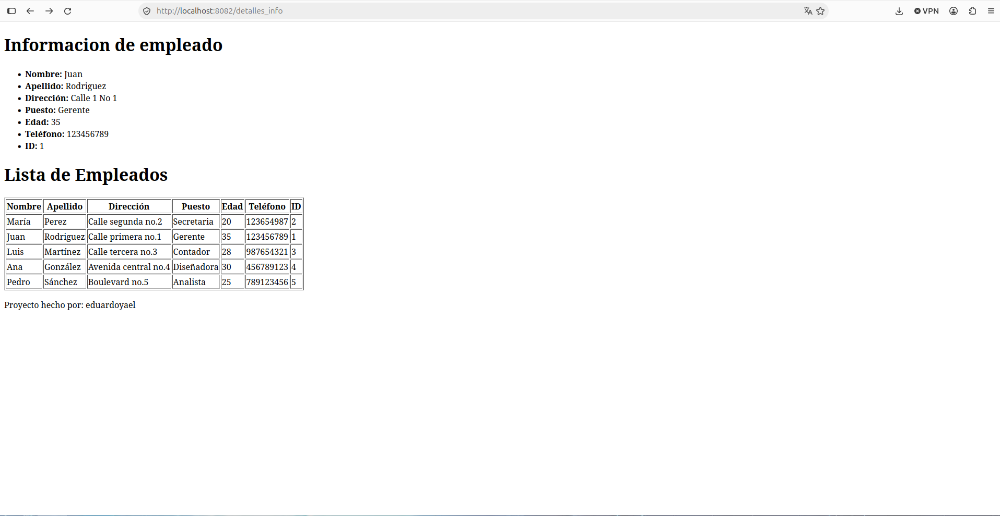
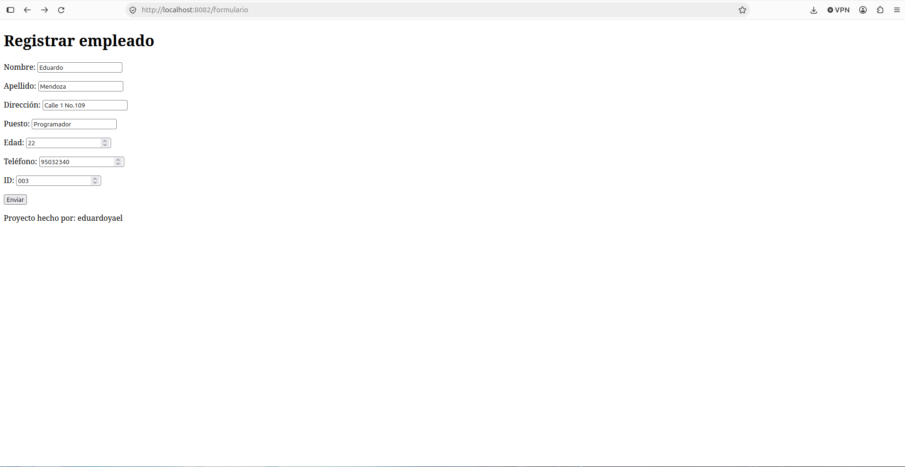
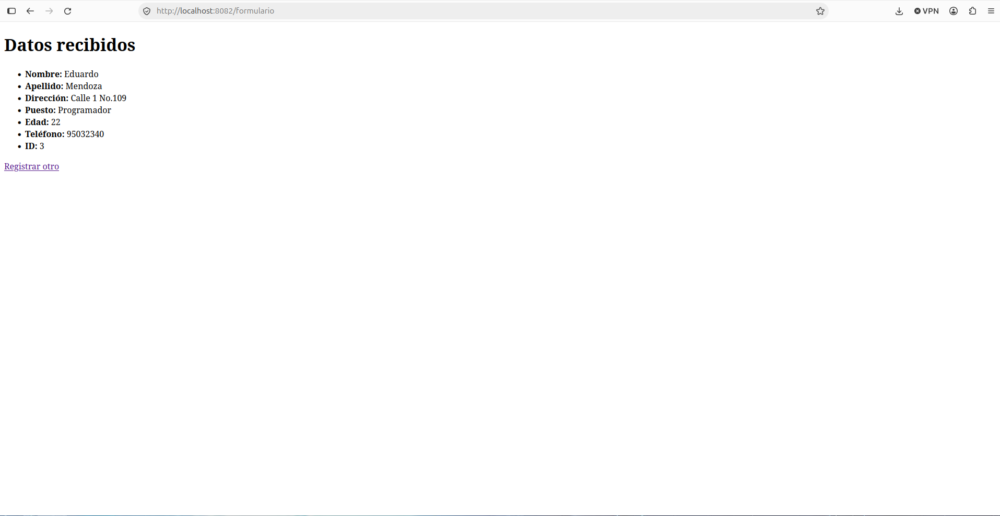
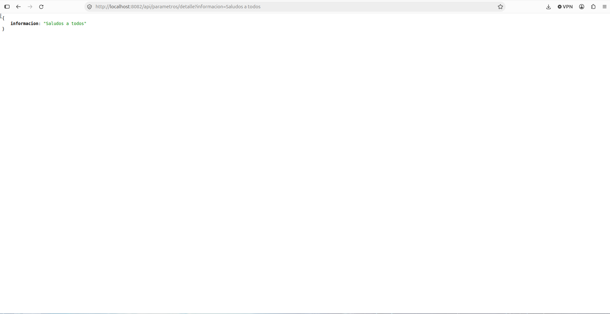
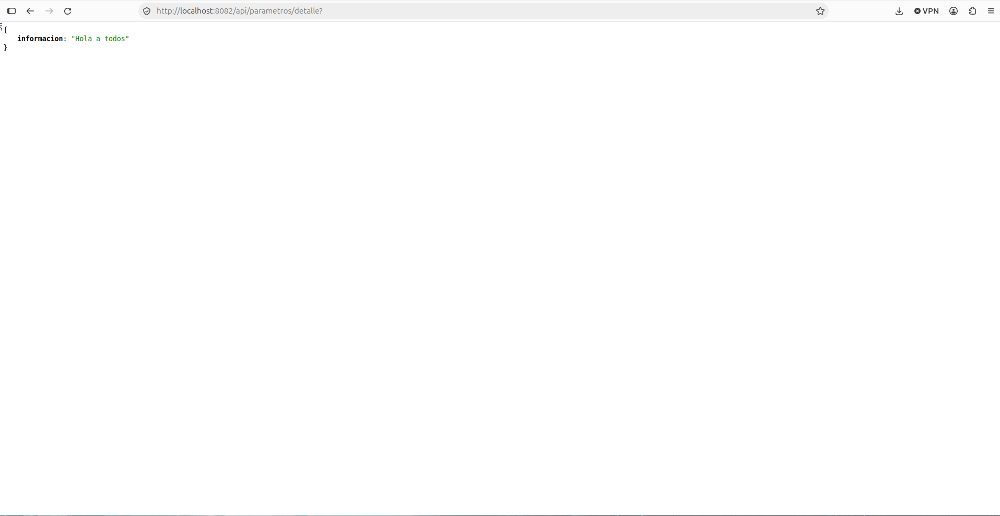
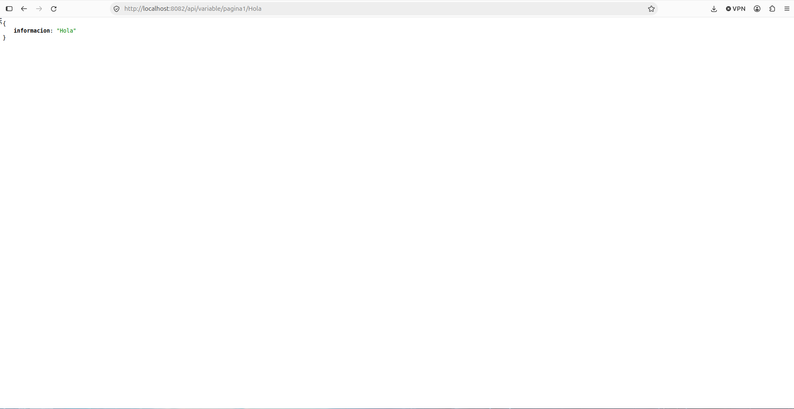
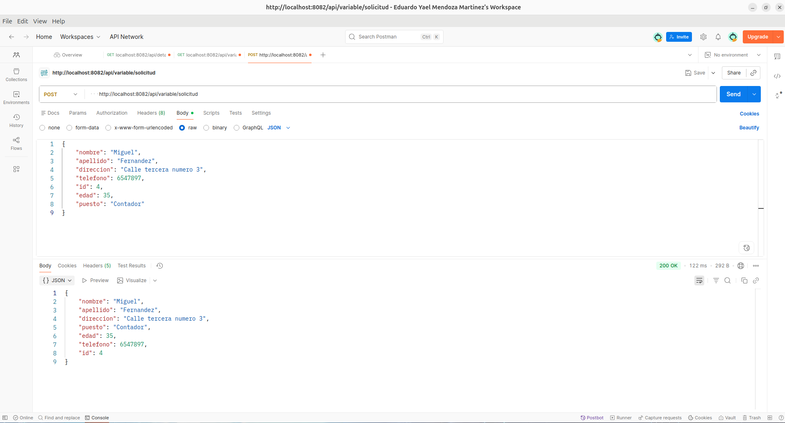

# MMEYact2_t4 - MVC con Thymeleaf, DTO y parámetros en Spring Boot

Proyecto de la Actividad 2 del Tema 4. Es una copia del proyecto de la Actividad 1 ([MMEYact1_t4](https://github.com/EduardoY24/MMEYact1_t4)) a la que se le agregó Thymeleaf, una clase DTO, `@RequestParam`, `@PathVariable`, `@ModelAttribute`, `@Value` y un endpoint POST, siguiendo los videos 8 al 17 del curso.

**Alumno:** Mendoza Martínez Eduardo Yael

## Proyecto en el VPS
- Actividad 2 (este proyecto) corre en el puerto **8083**: http://194.195.86.95:8083/detalles_info
- Actividad 1 sigue corriendo en su puerto original **8082**: http://194.195.86.95:8082/nombre

## Estructura MVC
- **Modelo:** `models/dto/EmpleadoDTO.java` (datos del empleado)
- **Vista:** `templates/detalles_info.html`, `formulario.html` y `resultado.html` (Thymeleaf)
- **Controlador:** `EjemploController` (regresa vistas), `PathVariableController` y `RquestParamControllers` (regresan JSON)

## Endpoints

| Controlador | Método | Endpoint | Qué hace |
|---|---|---|---|
| EjemploController | GET | `/detalles_info` | Vista con un empleado y la lista con `th:each` |
| EjemploController | GET | `/formulario` | Vista con el formulario |
| EjemploController | POST | `/formulario` | Recibe el formulario con `@ModelAttribute` y muestra los datos |
| RquestParamControllers | GET | `/api/parametros/detalle?informacion=...` | Usa `@RequestParam` |
| PathVariableController | GET | `/api/variable/pagina1/{mensaje}` | Usa `@PathVariable` |
| PathVariableController | POST | `/api/variable/solicitud` | Recibe un `EmpleadoDTO` con `@RequestBody` y lo regresa en JSON |
| PathVariableController | GET | `/api/variable/valores` | Muestra valores leídos con `@Value` |

## Capturas

### Lista con th:each y @Value

### Formulario con @ModelAttribute

### @RequestParam
Con parámetro:

Sin parámetro (valor por defecto):

### @PathVariable

### Petición POST en Postman

## Cómo correrlo en tu compu
    ./mvnw spring-boot:run

Luego abre http://localhost:8082/detalles_info

## Cómo generar el .jar
    ./mvnw clean package

El archivo queda en `target/mmeyact1_t4-0.0.1-SNAPSHOT.jar`.
